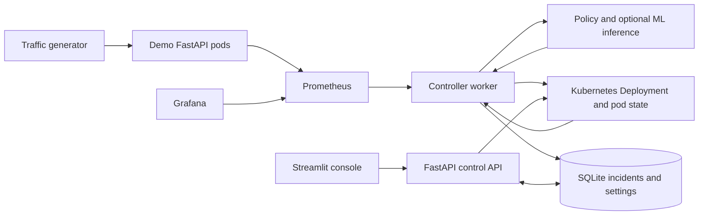

# Architecture and implementation

## Purpose and scope

HealLab studies a closed feedback loop for infrastructure recovery: observe a running service, infer a supported cause, choose a constrained action, execute it, and check whether users receive healthy responses afterward. The current deployment is one disposable **kind** cluster (`kind-heal-lab`), one namespace (`heal-demo`), and one application Deployment (`demo`). The controller runs in Docker Compose outside the cluster. This boundary lets the demo service fail without taking down the controller.

The current goal is a reproducible local prototype. A general multi-cluster or multi-cloud platform is a future goal, not an implemented deployment.

## System map

The worker polls every 15 seconds. Prometheus scrapes every 15 seconds. The worker combines Prometheus request and process metrics with Kubernetes Deployment state, stores recent telemetry, and records incident events in SQLite. The control API exposes that state to Streamlit and accepts mode and controlled-experiment changes. Grafana reads Prometheus directly.

## Runtime components

| Component | Code or manifest | Responsibility |
| --- | --- | --- |
| Demo workload | `demo/app.py`, `infra/demo.yaml` | Two FastAPI replicas, `/work`, probes, Prometheus metrics, opt-in fault modes |
| Background traffic | `infra/load.yaml` | Approximate five requests per second so health can be judged from real requests |
| Prometheus and kube-state-metrics | `infra/monitoring.yaml` | Request/process metrics and Kubernetes state; six-hour or 256 MB Prometheus retention |
| Telemetry and Kubernetes adapter | `controller/adapters.py` | Query fresh metrics and read or patch the allowlisted workload |
| Pure policy | `controller/core.py` | Diagnose, forecast, check health and action safety without Kubernetes calls |
| Worker | `controller/worker.py` | Poll, persist, deduplicate, execute, verify, reconcile after restart |
| SQLite store | `controller/store.py` | Settings, incident records, event timeline; WAL mode |
| Optional ML inference | `controller/ml.py` | Load `data/model.joblib` and attach anomaly score/version |
| Control API | `controller/api.py` | Status, history, incidents, mode, and demo fault endpoints |
| Streamlit console | `console/app.py` | Live cards, charts, incident timeline, recovery mode and experiment controls |
| Grafana | `infra/grafana/` | Provisioned dashboard and read-only anonymous viewer access |
| React control room | `Frontend/` | Overview, incident details, and experiment controls; local Bun proxy connects to FastAPI; launched separately from Compose |

`compose.yaml` starts `api`, `worker`, `console`, and `grafana`. The API, worker, and console share `heallab-control:local`, built from `Dockerfile.control`. The demo image is built separately from `Dockerfile` and loaded into kind. The API is bound to localhost port 8000, Streamlit to 8501, and Grafana to 3000. The demo and Prometheus use kind NodePorts 30080 and 30090, reachable from containers on the kind Docker network.

## Observation and state

An observation contains timestamp, request rate, error fraction, p95 latency, maximum pod resident memory, memory limit, maximum process CPU rate, ready and desired replicas, revision annotation, validity, and rollout completion. The adapter requires `up == 1` for all demo scrape targets and a scrape age no greater than 45 seconds; it rejects absent or nonfinite metrics. Most request metrics use one-minute Prometheus rates. A new observation is timestamped when the worker collects it, so the freshness checks on action authorization apply to the assembled observation as well as to scrape age.

Recent history is held in the worker and copied into SQLite settings for `/telemetry/history`. It is bounded to 60 observations and is rebuilt after worker restart. The incident and event tables persist across restarts. `/incidents` returns the newest 200 incidents; the database itself has no retention policy. The worker stores the current mode, baseline template, cooldown timestamp, condition key, experiment state, telemetry, and errors in SQLite settings. `data/` is intentionally ignored by Git.

## Trust and control boundary

The controller Kubernetes credential is a namespace-scoped service-account token written to `data/kubeconfig` by setup and valid for 24 hours. Its Role permits reading and deleting pods, reading events, and reading/patching the `demo` Deployment and scale subresource in `heal-demo`. Code further fixes the workload name and checks an action allowlist. The API is a **local demonstration API without user authentication**. Ports exposed through Compose bind to `127.0.0.1`; do not treat the API or anonymous Grafana setting as suitable for a shared or public network.

The deployment has one worker by design. SQLite and the in-process history/active-incident state do not provide coordination for multiple workers. Worker restart reconciliation verifies an already executing action instead of issuing it again.

## Source map

- `controller/`: decision functions, Kubernetes/Prometheus adapter, worker, API, persistence, ML inference.
- `demo/`: instrumented FastAPI service and controlled faults.
- `console/`: operational Streamlit console; `.streamlit/` holds its theme.
- `infra/`: kind, demo, traffic, monitoring, and Grafana configuration.
- `scripts/`: setup/stop, fault injection, load, data collection, model training, smoke checks, reports.
- `tests/`: policy, adapter, API, worker, ML, and Streamlit component tests.
- `data/`: local runtime state and experimental outputs; never commit credentials or model artifacts from here.

For the exact decision thresholds and incident lifecycle, see [Recovery policy](RECOVERY_POLICY.md).
