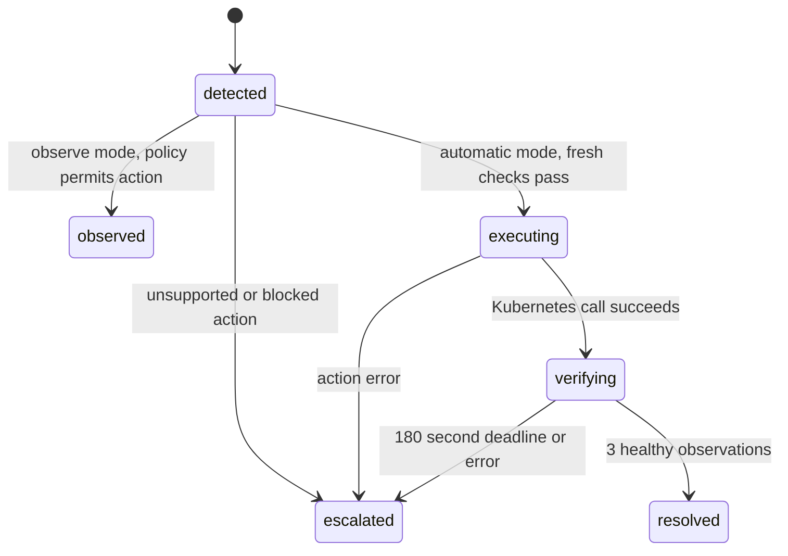

# Diagnosis and verified recovery

## Why the loop has two decisions

HealLab separates **diagnosis** (what the observations suggest) from **authorization** (whether acting is safe now). A diagnosis may create an incident in observe mode or be escalated without an action. An Isolation Forest anomaly is attached as evidence; it cannot authorize a Kubernetes mutation by itself. The distinction makes a policy decision reviewable and keeps uncertain cases under human control.

The policy functions are in `controller/core.py`; infrastructure calls are in `controller/adapters.py`. The worker in `controller/worker.py` joins them.

## Detection and diagnosis

The worker observes every 15 seconds. Rules generally require three valid, consecutive observations with no gap over 45 seconds. Because request rates use a trailing one-minute window, detection after a fault is not instantaneous. A one-off spike should not trigger a diagnosis.

Rules are checked in this order:

| Evidence | Cause | Proposed action |
| --- | --- | --- |
| Error fraction above 10% in all three observations **and** current revision differs from the saved healthy revision | `faulty_revision` | `rollback` |
| Same sustained errors without that known revision change | `unknown_errors` | Manual review |
| Stable positive memory trend, estimated time to limit under 300 seconds, current memory over 55% of limit | `memory_growth` | `replace_pod` |
| CPU above 0.15 cores and p95 latency above 0.4 seconds in all three observations | `overload` | `scale` |
| p95 latency above 1 second or fewer than one ready replica in all three observations | `unknown_degradation` | Manual review |
| Three consecutive model anomalies with no supported rule diagnosis | `ml_anomaly` | Manual review |

The memory estimate uses up to 12 valid recent points, requires at least six, rejects gaps over 45 seconds, fits a straight line, and requires a positive slope and R-squared of at least 0.8. It estimates time to the configured 256 MiB memory limit. This is a narrow trend estimate, not a general outage prediction. The policy threshold `memory / memory_limit > 0.55` reduces action on small early changes.

## Healthy state and rollback baseline

An observation is healthy when telemetry is valid, rollout is complete, request rate is positive, at least two replicas are ready, errors are below 2%, p95 latency is below 0.4 seconds, and memory is below 80% of its limit. The controller requires a stable healthy revision for at least 90 seconds and three healthy recent observations before saving its pod template as a rollback baseline. A new or incomplete rollout cannot inherit the old revision's healthy history.

The saved template is the rollback target; it is not a generic `kubectl rollout undo`. If no verified baseline exists, sustained errors are treated as unknown and require manual review. Operators should wait until the console says **Rollback baseline available** before injecting an error revision.

## Action authorization

Before an automatic action, the worker checks the latest observation and then obtains a fresh observation and checks again. It requires:

- Valid, finite telemetry no older than 45 seconds and not from the future.
- At least five minutes since the last automatic action.
- An allowlisted action: `rollback`, `scale`, or `replace_pod`.
- Fewer than three desired replicas before scaling.
- At least two ready replicas before replacing one pod.
- Current mode `automatic` at the final check.

Observe mode records a diagnosis and policy result but takes no automatic action. **Stop new recovery actions** sets observe mode; an action already in verification continues to be checked. Each incident receives at most one action attempt. An API or Kubernetes failure escalates the incident; the system does not silently retry an uncertain mutation.

## What each action does

| Action | Kubernetes operation | Intended effect and limit |
| --- | --- | --- |
| `rollback` | Patch the `demo` Deployment pod template to the verified healthy template | Restore a known healthy revision after a bad rollout; depends on the baseline being valid |
| `scale` | Patch the Deployment scale subresource to at most three replicas | Add one replica for supported CPU/latency overload; cannot fix an application bug or exhausted shared dependency |
| `replace_pod` | Choose the ready demo pod with highest Prometheus resident memory and delete it with a UID precondition | Temporarily remove the most affected pod; a leak in the template can recur in the replacement |

The Kubernetes Role restricts the namespace and Deployment; the adapter fixes the workload name to `demo`. The adapter independently checks ready pod count and requires pod-level memory evidence before replacement.

## Incident lifecycle

The event timeline records policy decisions, action results or errors, verification, and restart reconciliation. A Kubernetes API success only means the mutation was accepted. **Resolved** requires three subsequent healthy observations with real request traffic. If verification fails or the 180-second deadline expires, the incident is **escalated**. After worker restart, an `executing` or `verifying` incident is reobserved and verified without replaying the action.

The worker deduplicates a continuing cause in a given mode through a persisted condition key. A healthy observation clears that key, allowing a later recurrence to create a new incident. This is a simple local mechanism, not a distributed incident correlation service.

## Theoretical framing

The loop resembles an autonomic **monitor, analyze, plan, execute** cycle with a knowledge store. Metrics and Kubernetes state provide observations; rules and optional ML provide analysis; the policy maps supported causes to bounded actions; the worker executes; post-action traffic closes the loop. The current design favors explicit safety invariants over broad automatic coverage. That is why unknown failures and model-only anomalies become manual incidents. See [ML and evaluation](ML_AND_EVALUATION.md) for what the model does and does not establish.
